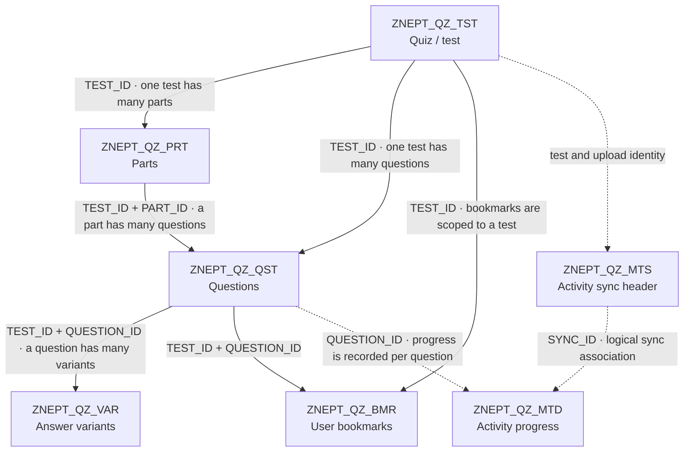

# Neptune Quiz App DB

ABAP database and backend layer for the Neptune Quiz application.

This repository contains the SAP ABAP database objects and backend logic used by the Demo Quiz application. It is designed to be used alongside the related application and CDS repositories:

- [Neptune Quiz App](https://github.com/eborzykh/Neptune-Quiz-App)
- [Neptune Quiz App CDS](https://github.com/eborzykh/Neptune-Quiz-App-CDS)
- [Neptune Quiz App SRC](https://github.com/eborzykh/Neptune-Quiz-App-SRC)

## Overview

The repository includes ABAP Dictionary objects, quiz data tables, and the `zcl_nept_qz_data_provider` class. The data model supports quiz content, bookmarks, and user activity progress and synchronization.

## Database structure and relationships

The core quiz content is organized as a hierarchy: a quiz contains parts and questions, and questions have answer variants. Bookmark and activity tables store user-specific state.

Solid arrows show relationships declared in the ABAP Dictionary metadata. Dashed arrows show logical associations used by the application; they are not all defined as database foreign-key constraints. `MANDT` (SAP client) is omitted from the diagram for readability.

### Table descriptions

| Table | Description |
| --- | --- |
| `ZNEPT_QZ_TST` | Quiz/test master record, including description, publication status, version, and upload details. |
| `ZNEPT_QZ_PRT` | Ordered parts or sections belonging to a test. |
| `ZNEPT_QZ_QST` | Questions belonging to a test and a part; includes question text, explanation, order, and version. |
| `ZNEPT_QZ_VAR` | Answer variants for a question; includes variant text, order, correctness, and version. |
| `ZNEPT_QZ_BMR` | Per-user bookmark state for a question within a test, with activity and sync timestamps. |
| `ZNEPT_QZ_MTS` | Activity-sync header identifying the user, test, upload version, and sync ID. |
| `ZNEPT_QZ_MTD` | Activity-progress records, including question, progress, activity time, and sync time. |

## Source layout

The `src/` directory contains the ABAP class and its test classes, package metadata, and serialized ABAP Dictionary objects such as tables, data elements, domains, and table types.

## Import

Import the repository into an SAP ABAP system using abapGit, then activate the package and its objects. The related application repositories may also be needed to run the complete application.

## License

This project is licensed under the MIT License. See the [LICENSE](LICENSE) file for details.
